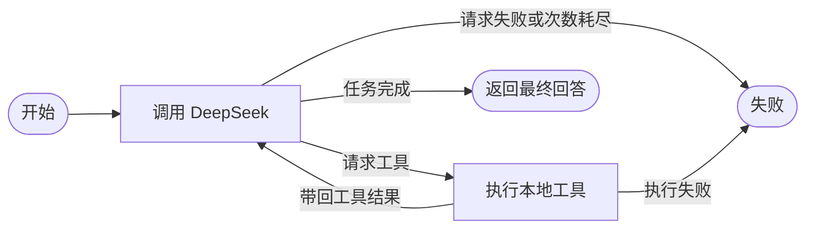

# Loom v0.1 范围说明

本范围已确认。Loom 是一个 Python Agent 框架。第一版用串行 Graph 运行 ReAct 循环。每次只执行一个节点，同一个节点可以反复执行。框架检查当前任务状态，运行中继续调度，完成时返回回答，失败时报告原因。使用者通过 `@tool` 标记函数并显式加入当前 Agent 的工具列表。见[使用方式](02-usage.md)。

## 第一版的图怎样运行

节点表示一个执行步骤，边决定接下来运行哪个步骤。Graph 支持入口、结束、顺序连接和按条件选边，每次只运行一个节点。模型通过原生工具调用请求选择工具，工具节点执行已注册的函数，然后将结果交给模型。循环可以走多轮。开发者也可以独立注册业务节点、指定入口、按信号连边，以自己的数据运行同一个 Graph。

## 第一版交付范围

| 项目 | 行为与边界 |
| --- | --- |
| 模型 | 单 Agent、单模型。通过 OpenAI Chat Completions 格式调用 DeepSeek 官方服务的对话及工具调用能力，使用者配置 DeepSeek 密钥和模型名。[官方接入文档](https://api-docs.deepseek.com/zh-cn/) · [工具调用指南](https://api-docs.deepseek.com/zh-cn/guides/tool_calls/) |
| 工具 | 开发者提供可信的同步 Python 函数，框架向模型描述可用工具并在本地执行。函数可以计算、查询数据库或访问外部 API。v0.1 采用 `@tool`、函数名、文档字符串和类型注解，支持必填的 `str`、`int`、`float`、`bool` 参数及 `str` 返回值。 |
| 任务 | 同步执行并返回最终文本。本次任务保留模型与工具的往返记录，每次新任务独立开始。 |
| 执行边界 | 每个任务有模型调用次数上限，每次模型请求有超时。可信工具在本进程中执行，由开发者保证及时返回。配置及运行错误应可识别。 |
| 交付物 | 可导入的 Python 库、安装说明、一个可运行的工具调用示例，以及覆盖以下执行路径的测试。 |

第一版开放三个扩展点：普通 Python 节点函数、实现 `complete` 的模型适配器、通过 `@tool` 注册的工具函数。DeepSeek 是内置适配器。并行分支、异步调度、多 Agent、流式输出、跨任务会话、长期记忆、RAG、内置业务工具、MCP、图形界面、服务端部署、沙箱、自动重试与断点恢复均在 v0.1 范围之外。

## 验收条件

1. **直接回答。** 模型给出最终文本后，图从模型节点走到结束，工具调用次数为零。
2. **执行工具。** 运费示例中，模型请求计算 2.5 千克包裹的运费，本地工具按每千克 8 元返回 20 元，模型根据结果回答。模型也可以在拿到结果后再次请求工具，重复上述路径直至完成。
3. **有限停止。** 让模型持续请求能正常返回的工具，图应在配置的模型调用次数用完后停止，且能向调用者说明原因。模型请求超过超时也应报告失败。

4. **独立编排。** 用两个普通函数和业务状态运行一张图，验证分支、终点及纯业务回环的步数上限。
5. **替换模型。** 将可控的模型适配器传入同一 Agent 模板，验证结果和工具调用可在本地复现。

每轮状态判定、工具请求关联和失败处理见[基础协议](03-protocol.md)。
